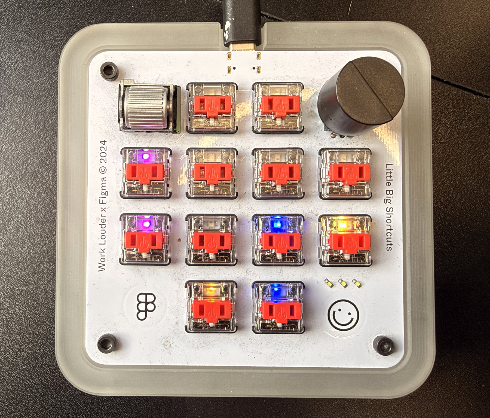
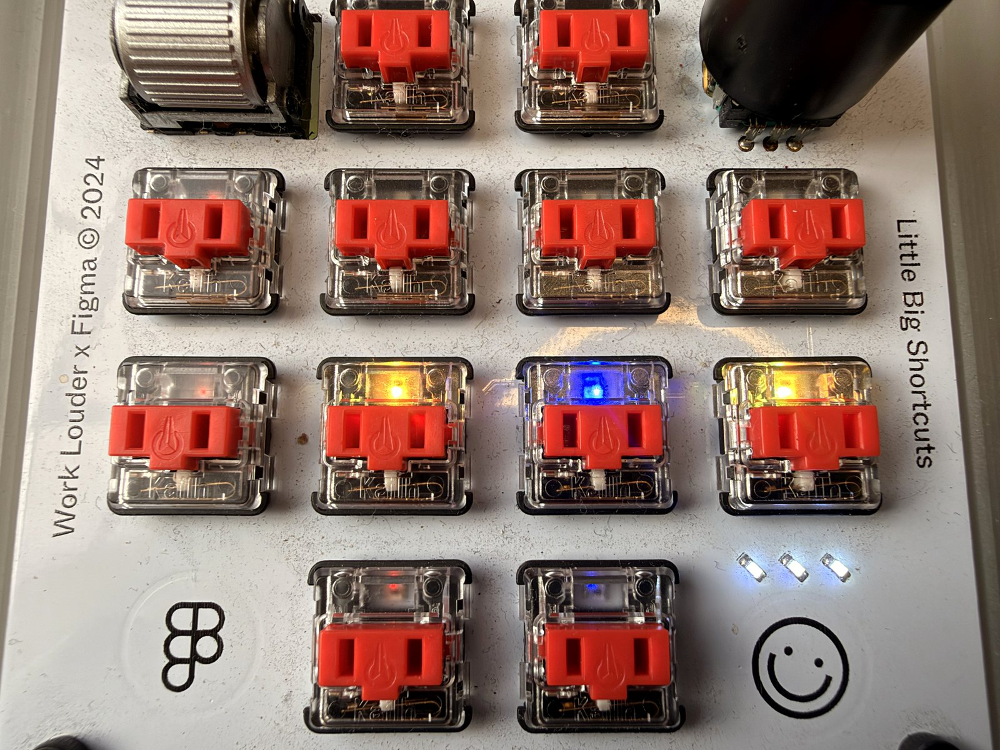
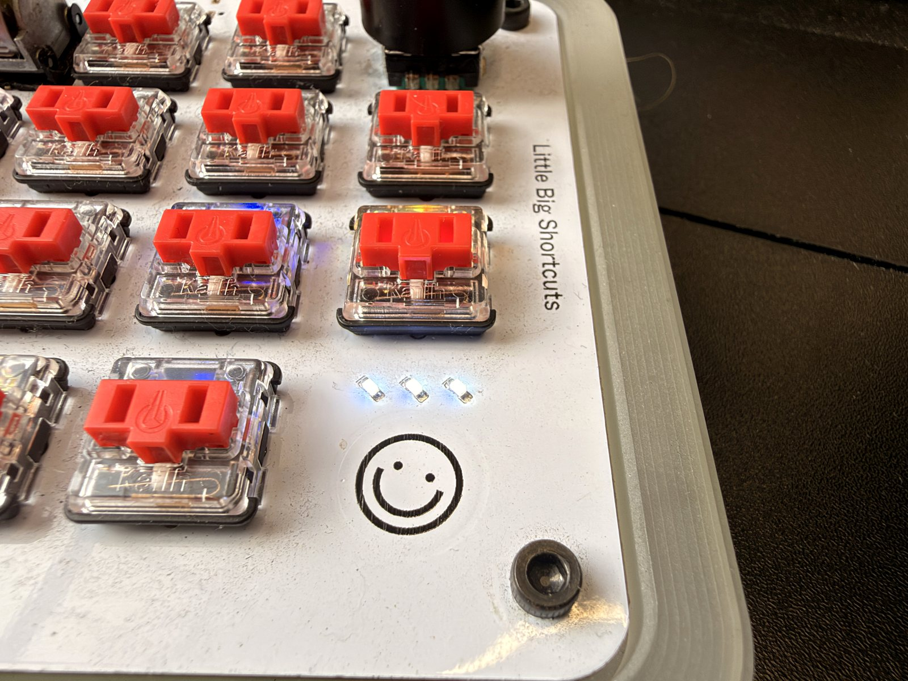
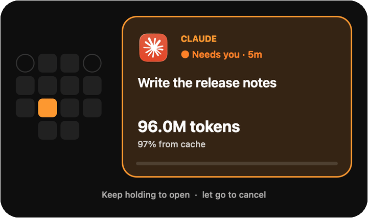
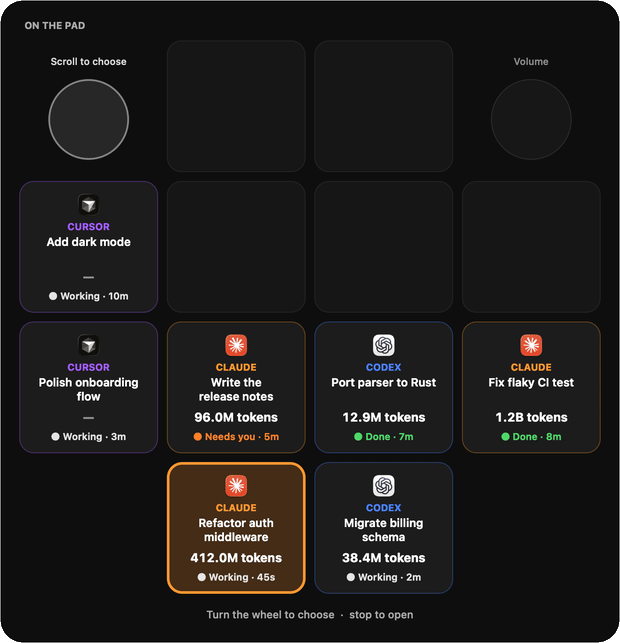
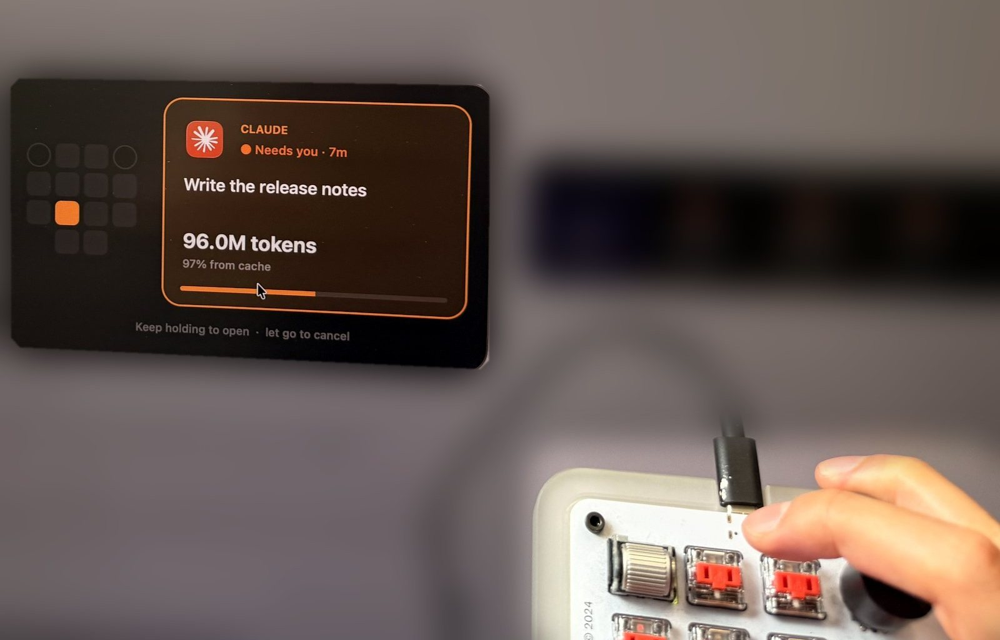
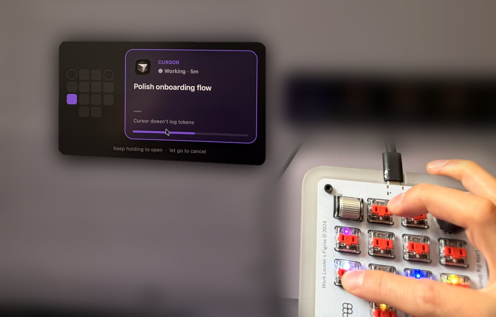
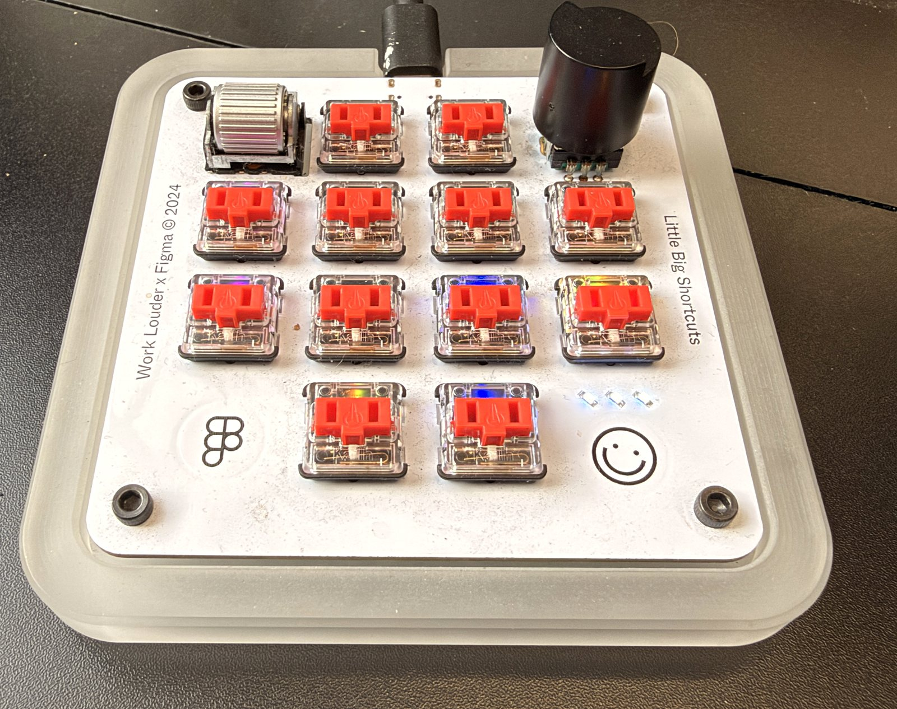

<p align="center">
  
</p>

<h1 align="center">Micropad Agent</h1>

<p align="center">
  <b>Every AI agent, one key.</b><br>
  Live Claude, Codex and Cursor sessions on a Work Louder × Figma Micro Pad.
</p>

<p align="center">
  <a href="#install">Install</a> ·
  <a href="#how-it-works">How it works</a> ·
  <a href="#reference">Reference</a>
</p>

<br>

### One key per session.

Every running agent gets its own key, coloured by app: **Claude amber**, **Codex
blue**, **Cursor violet**. Working sessions breathe. Keys fill from the bottom row
up, so the newest work sits under your fingers.

<p align="center">
  
</p>

### It taps you on the shoulder.

When an agent needs an answer or a permission, its key blinks and the three white
LEDs pulse. When one finishes, the underglow turns green, the white LEDs flash
three times, and the key flashes for ten seconds, then stays lit until you look.

<p align="center">
  
</p>

### Hold to open.

Press a lit key and its session appears on screen. Keep holding for a second and
the window opens: Claude, Codex, or Cursor's Agents window. Let go to cancel.

<p align="center">
  
</p>

### Scroll to switch.

The wheel walks through your sessions laid out in the shape of the pad, then
through your most recent ones. Stop turning and the selected session opens.

<p align="center">
  
</p>

### On your desk.

The panel appears wherever you're working and gets out of the way when you let go.

<p align="center">
  
  
</p>

### Tokens, at a glance.

Every card shows how many tokens that session has burnt and how much of it came
from cache, read from the apps' own logs. Claude counts include subagents. Cursor
doesn't record token counts on disk, so its cards say so rather than guess.

### Sees what the apps see.

Sessions come from each app's own files, so the pad matches what Claude.app
(including remote SSH sessions), the Codex app and CLI, and Cursor show. No
plugins, no polling of your screen, nothing leaves your Mac.

### Native and tiny.

A menu bar app in a single AppKit file: a dot per live session, a menu to open any
of them, and the switcher panel. About 14 MB of memory, fed by a push stream from
the daemon instead of polling.

<p align="center">
  
</p>

<br>

## Install

**You need** a Work Louder × Figma Micro Pad, a Mac on macOS 14 or later,
[Homebrew](https://brew.sh), and Xcode or the Command Line Tools (for the menu bar
app).

**1. Flash the firmware (once).** Hold the top-left wheel while plugging the pad
in to enter its bootloader, then flash the prebuilt image:

```bash
brew install dfu-programmer
dfu-programmer atmega32u4 erase --force
dfu-programmer atmega32u4 flash firmware/work_louder_micro/agent/work_louder_micro_agent.hex
dfu-programmer atmega32u4 reset
```

QMK Toolbox works too. Your VIA keymap keeps working; later updates flash
hands-free with `./flash-when-ready.sh`.

**2. Install.**

```bash
git clone https://github.com/josefchen/micropad-agent.git
cd micropad-agent
./bootstrap.sh --per-key
```

This installs the daemon as a login item that restarts itself, wires up the Claude
Code and Codex hooks, and builds the menu bar app. Run it again any time; it's
idempotent. `./bootstrap.sh --uninstall` removes everything.

<details>
<summary><b>No flashing?</b></summary>
<br>

`./bootstrap.sh` without `--per-key` runs the original whole-pad status light on
the stock firmware: every key shows the most urgent state across your agents. It
needs no firmware change, but you get one shared light instead of a key per
session, and no hold-to-open or wheel switcher.

</details>

## How it works

```
Claude.app · Claude Code ─┐
Codex app · Codex CLI ────┼─▶ session files + hooks ─▶ daemon ─▶ raw HID ─▶ pad
Cursor Agents ────────────┘                              │
                                                         └─▶ /events ─▶ menu bar app
```

- **Daemon** (`daemon_perkey.py`, `sources.py`). Reads every app's session state,
  gives each live session a key, and sends the pad one byte per key over VIA's raw
  HID channel. It listens on `127.0.0.1` only; anything that opens a window needs
  an `X-Micropad` header, so web pages can't trigger it.
- **Firmware** (`firmware/`). A small QMK keymap that paints each key from the state
  byte, animates breathing, blinking and the done flash on the pad itself, and
  reports key presses, releases and wheel turns back to the Mac.
- **Menu bar app** (`mac/`). One Swift file, plain AppKit, no SwiftUI or WebKit.
- **Dashboard.** A live mirror of the pad at
  [127.0.0.1:48801](http://127.0.0.1:48801/).

## Reference

| Light | Meaning |
|---|---|
| Amber · blue · violet, breathing | Claude · Codex · Cursor session working |
| Key blinking, white LEDs pulsing | Needs you |
| Green underglow, white LEDs flash ×3, key flashes 10 s | Just finished |
| Key solid | Finished, not opened yet |
| Red | Error |

| Control | Action |
|---|---|
| Press a lit key | Show that session on screen |
| Hold it 1 s | Open it |
| Turn the wheel | Walk through sessions, then recent ones |
| Stop turning | Open the selected session |
| Knob | Volume |

<details>
<summary><b>Configuration</b></summary>
<br>

- `MICROPAD_NOTIFY=0` in the daemon's environment turns off macOS notifications.
- `./demo.sh showcase | working | needs | done | off` stages sample sessions on the
  pad and in the app for photos and recordings. Holding a demo key opens its app,
  or the session named for that app in `~/.config/micropad/demo.json`
  (`{"claude": "local_…", "codex": "<thread id>", "cursor": "<composer id>"}`).
- `Micropad --render out.png [--hold 0.6]` draws the switcher panel from live
  state to a PNG.

</details>

<details>
<summary><b>Repository layout</b></summary>
<br>

| Path | What it is |
|---|---|
| `daemon_perkey.py`, `sources.py` | Per-key daemon and the session readers |
| `daemon.py` | Whole-pad daemon for stock firmware |
| `firmware/` | QMK keymap and prebuilt image |
| `mac/` | Menu bar app and its build script |
| `hooks/` | Claude, Codex and Cursor hooks; window focusing |
| `tools/` | Keymap backup and restore, VIA layers, diagnostics |
| `tests/` | `./run.sh -m unittest discover -s tests` |
| `docs/` | Protocol notes and media |

</details>

<details>
<summary><b>Gotchas</b></summary>
<br>

- **Close the VIA web app while the daemon runs.** WebHID takes the pad exclusively
  and the lights go dark.
- **Stop the daemon with launchctl, not `pkill`.** launchd restarts it:
  `launchctl bootout gui/$(id -u)/dev.micropad.agent`.
- **Keymap tools need the pad to themselves.** Stop the daemon before running
  `tools/via_keymap.py` or `tools/layers.py`; `flash-when-ready.sh` does this for you.
- **Hardware.** USB `0x574C:0xE6E3`, raw HID usage page `0xFF60`, 12 keys with
  WS2812 LEDs, two encoders, three white indicator LEDs. Protocol notes in
  [docs/per-key-led-design.md](docs/per-key-led-design.md).

</details>

## Credits

Built on [kimtoma/micropad-agent](https://github.com/kimtoma/micropad-agent) by
Kim Kyung Soo, which first turned this pad into an agent status light. Hardware by
[Work Louder](https://worklouder.cc) × Figma.

## License

[MIT](LICENSE)
